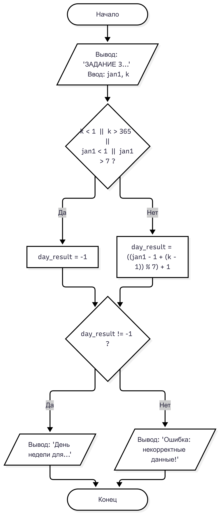

# Лабораторная работа № 7
## 1. Условие задачи, 6 Вариант
Дано число N (N<1000). Написать программу, которая проверяет входит ли в него цифра 5.

 

## 2. Реализация программы
```
#define _CRT_SECURE_NO_WARNINGS
#include <stdio.h>
#include <windows.h> // не работает #include <locale.h>

int get_day_of_week(int jan1, int k); 

int main() {
    SetConsoleOutputCP(65001); 

    int jan1, k;

    printf("ЗАДАНИЕ 3: Определение дня недели\nВведите день недели 1 января (1-Пн, ..., 7-Вс): ");
    scanf("%d", &jan1);
    printf("Введите номер дня в году k (1-365): ");
    scanf("%d", &k);
    int day_result = get_day_of_week(jan1, k);
    if (day_result != -1) {
        printf("День недели для %d-го дня года: %d\n", k, day_result);
    }
    else {
        printf("Ошибка: некорректные данные!\n");
    }
    return 0;
}


int get_day_of_week(int jan1, int k) {
    if (k < 1 || k > 365 || jan1 < 1 || jan1 > 7) {
        return -1;
    }
    return ((jan1 - 1 + (k - 1)) % 7) + 1;
}
```

## 3. Результаты работы программы

ЗАДАНИЕ 3: Определение дня недели
Введите день недели 1 января (1-Пн, ..., 7-Вс): 6
Введите номер дня в году k (1-365): 333
День недели для 333-го дня года: 2

## 4. Информация о разработчике

 Воропаева Дарья БИД-261
